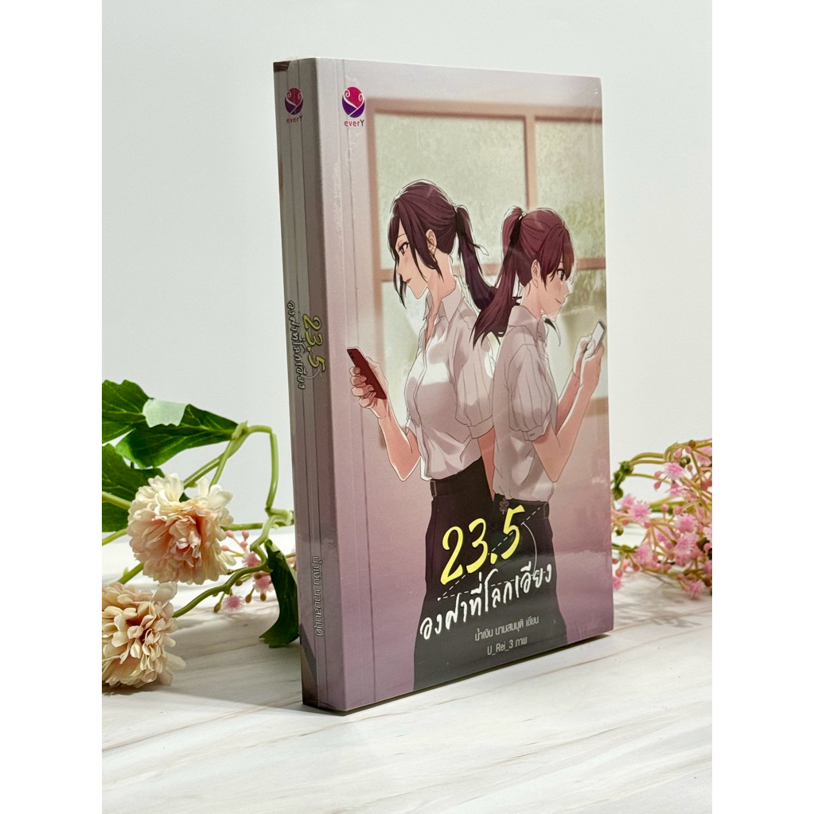

# 23.5 Degrees — Story Reader

A personal story-reading and listening app dedicated to **23.5 Degree the World Incline**.

Built with passion to preserve a story I love and make it accessible in both English and Vietnamese. This project started because I couldn't find a version of this story with the translation I was looking for on other platforms, so I decided to create my own reading experience.

## ✨ About the Project

**23.5 Degrees — Story Reader** is a personal project made for the love of stories.

The app currently focuses exclusively on _23.5 Degree the World Incline_. It provides a simple, comfortable place to read and listen to the story, with support for both **English and Vietnamese**.

This is a standalone application. You can download the project, install its dependencies, and run it without setting up a backend or database server.

## 📚 Features

- **Read Stories** — Enjoy the story through a dedicated reading interface.
- **Listen to Stories** — Listen to story content with the app's audio features.
- **Bilingual Support** — Switch between English and Vietnamese for both the app interface and story content.
- **Light and Dark Themes** — Choose an appearance that suits your reading environment.
- **Local Assets** — Story content and bundled audio can be stored locally within the app.
- **No Backend Required** — No API server or remote database setup is needed.
- **Responsive UI** — Designed to provide a comfortable experience across different screen sizes.

## 🌐 Languages

| Content       | Supported Languages                                                                                                                                        |
| ------------- | ---------------------------------------------------------------------------------------------------------------------------------------------------------- |
| App Interface |  English,  Vietnamese |
| Story Content |  English,  Vietnamese |

## 🛠️ Tech Stack

- **React Native** — Cross-platform mobile application framework
- **Expo** — Development and application tooling
- **Expo Router** — File-based navigation
- **TypeScript** — Type-safe development
- **i18next / react-i18next** — Internationalization
- **Local Assets** — Bundled story content, images, and audio

## 🚀 Getting Started

### Prerequisites

Before running the app, make sure you have:

- [Node.js](https://nodejs.org/) installed
- npm installed
- [Expo Go](https://expo.dev/go) on your mobile device, or an emulator/simulator for development

### Installation

1. Clone this repository:

   ```bash
   git clone <repository-url>
   ```

2. Navigate to the project directory:

   ```bash
   cd <project-directory>
   ```

3. Install dependencies:

   ```bash
   npm install
   ```

4. Start the development server:

   ```bash
   npx expo start
   ```

5. Open the app using Expo Go or run it on your preferred emulator or simulator.

> **No backend setup is required.** The app is designed to use locally bundled story content and assets.

## 📖 Current Story

### 23.5 Degrees

The app currently focuses on one story: _23.5 Degree the World Incline_.

The goal is to provide a dedicated space to read and listen to the story in English and Vietnamese, with a comfortable interface for enjoying it at your own pace.

More stories may be considered in the future, but this project is currently dedicated to this title.

## 🎯 Motivation

Sometimes, a project begins with something simple: wanting to keep a story close.

I created this app out of passion for reading, a desire to preserve a story I love, and the difficulty of finding the translation I wanted on other platforms.

Rather than building a large platform, I wanted to create a lightweight, personal reading and listening experience that I could maintain and enjoy.

This project is a way to combine my interest in software development with my love for stories.



## ⚠️ Disclaimer

This is a non-commercial, fan-made project created for personal and educational purposes.

All rights to the original story and its characters belong to their respective copyright holders. Translations and other story-related materials may belong to their respective authors or translators.

This project is not affiliated with or endorsed by the original creators or copyright holders.

Please support the original creators and official releases whenever possible.

## 💙 Made with Passion

Built with love for stories, language, and software development.

_Sometimes, the best way to preserve a story is to build a little place for it._
